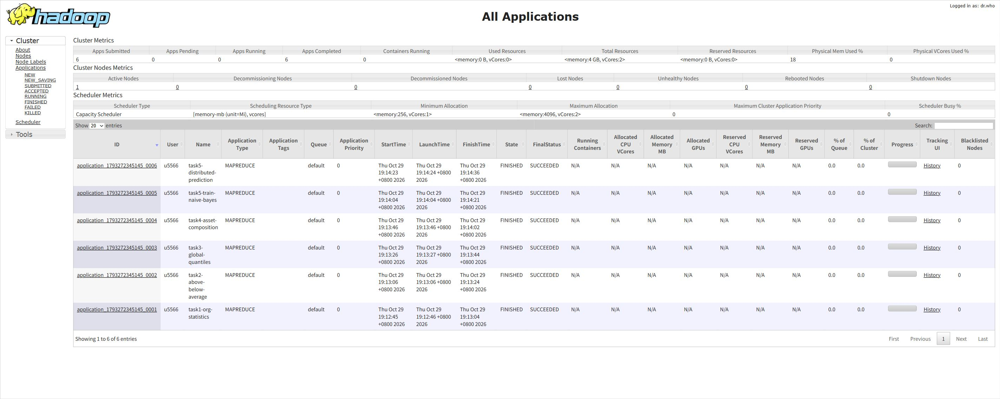
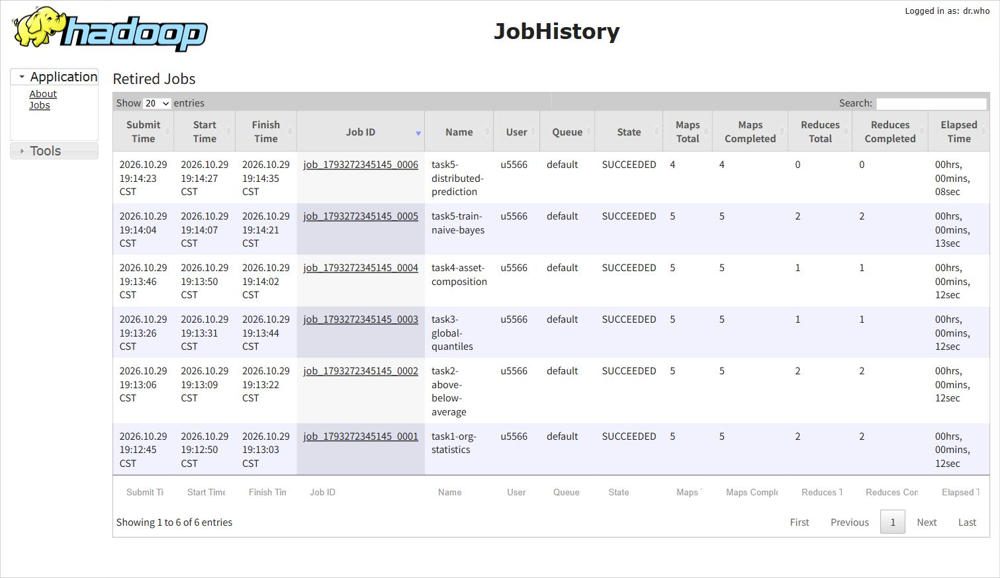

# 实验二：基于 MapReduce 的用户信贷数据分析

## 完成情况

已实现全部五项任务，并使用 Downloads 中的原始 `train.csv`、`test.csv` 在 **WSL Ubuntu、Java 11、Hadoop 3.3.6 的单机 YARN/HDFS 环境**实际执行。五项任务拆分为六个 Hadoop Job（任务五分别训练与预测），全部状态为 **SUCCEEDED**，真实网页截图已附在报告中。提交包 `output/` 为本次 HDFS 导出的结果；独立校验见 `verification/cluster-validation.json`。

此外，还完成了 Windows LocalJobRunner 的单分片、多分片和边界样例验证。对应日志见 `verification/hadoop-run.log`、`hadoop-multimap.log`、`hadoop-edge.log`。单机 YARN 结果与此前独立验证通过的结果完全一致。

本项目没有把 Python 计算结果冒充 Hadoop 输出：`output/` 中的数据来自 Java Hadoop Job；Python 仅用于独立复算与核验。

## 目录

```text
credit-mapreduce/
├── src/main/java/edu/lab/CreditAnalysis.java
├── src/main/resources/log4j.properties
├── target/credit-mapreduce.jar
├── output/
│   ├── task1/ ... task5/       原始 Hadoop 输出及 _SUCCESS
│   ├── model/                朴素贝叶斯模型统计量
│   └── _*.tsv                作业间分布式缓存文件
├── scripts/
│   ├── run.sh                Hadoop 集群执行入口
│   ├── run-local.ps1         Windows 本地执行入口
│   ├── verify.py             独立验证程序（仅 Python 标准库）
│   └── windows-compat/       仅本地环境使用的兼容适配器源码
├── tests/                    合成边界样例，与真实数据分开
├── verification/             日志、校验结果、截图说明
├── pom.xml
└── README.md                 实验报告
```

未重复打包原始数据；复现时使用原有 CSV。训练和测试文件的 SHA-256 记录在校验 JSON 中，防止混用其他版本。

## 一、数据与统一处理规则

训练集 285,285 条，测试集 189,766 条；各自客户 ID 无重复。训练集有 687 个开户机构。标签 0 共 280,401 条，标签 1 共 4,884 条。本实现按通常二分类口径将 `bad_good=1` 计为逾期；题目未单独给出标签编码解释，如课程另有字典，应以字典为准。

输入采用题目所给的 15 列训练表、14 列测试表，列序必须与提供的数据一致。每行一条 CSV，支持带引号字段、逗号以及双引号转义，不支持跨物理行字段。表头、UTF-8 BOM 和空行单独处理；缺失金额（空串、NA、NaN、null，不区分大小写）视为零。坏数字、非法标签、空客户 ID 和错误列数直接使任务失败，避免悄悄丢弃数据。机构缺失归入 UNKNOWN，模型中缺失标志也归入 UNKNOWN。真实训练集未发现上述数字缺失标记；缺失处理通过合成样例验证。

金额汇总使用 `BigDecimal`，避免二进制浮点累加误差。任务三按题目 double 字段定义采用 `DoubleWritable`，统计序号使用 long。所有结果为 UTF-8 文本。

## 二、设计思路

### 任务一：机构客户数、总资产、总负债、逾期数

Mapper 输出 `机构 → (1,资产,负债,标签)`。Combiner 在 Map 端局部加总，Reducer 合并四个统计量。使用两个 Reducer，可通过 `-Dcredit.reducers=N` 配置。各分区内部按机构键排序，题目不要求任务一输出文件之间全局排序。

汇总结果：总资产 **42,684,729,782.46**，总负债 **26,583,730,984.55**，逾期客户数 **4,884**。

真实输出示例：

```text
1002	793,85762009.43,28727466.60,5
1004	731,71218296.34,21648579.65,11
```

### 任务二：按机构平均资产比较

Driver 合并任务一各分区输出为小型统计表，使用 `Job.addCacheFile` 分发给每个 Mapper。Mapper 在 setup 中加载机构客户数 N 与资产和 S，并比较 `客户资产 × N ≥ S`，无需除法或四舍五入；相等归入高于组。Reducer 分别汇总两组人数，且每个机构两组人数之和必须等于任务一客户数。

```text
1002	106,687
1004	144,587
```

### 任务三：利用 Shuffle 的全局排序求四分位数

Mapper 输出 `DoubleWritable(资产) → 1`，设置 **一个 Reducer**，由 Hadoop Shuffle 按资产键升序排列全部记录；同资产客户的记录保留在该键的 values 中。Reducer 累加客户个数，在目标秩处记录资产。Mapper/Reducer 没有对客户资产调用 Java sort。

题目没有指定插值规则，本项目使用 **nearest-rank（最近秩）**：在从 1 开始的有序样本中取 `ceil(p × N)`。N 来自任务一实际成功处理的 Counter，任务三结束时核对扫描总数；本数据目标秩为 71,322、142,643、213,964。

```text
Q25:1127.35	Q50:6501.38	Q75:49173.11
```

不同软件的线性插值分位数可能略有不同，不能混用统计口径。

### 任务四：资产分层与配置结构

通过分布式缓存加载任务三结果，按以下互斥边界分层，重复资产不会被拆到不同层：

| 层级 | 条件 | 本次客户数 |
|---|---|---:|
| 低资产 | A ≤ Q25 | 71,322 |
| 中等资产 | Q25 < A ≤ Q50 | 71,321 |
| 较高资产 | Q50 < A ≤ Q75 | 71,321 |
| 高资产 | A > Q75 | 71,321 |

Mapper 输出层级及七种资产金额；单个 Reducer 汇总四层各七项资产。**占比分母取同层七类资产汇总额之和**，即该层所列资产配置结构的归一化比例，而不是客户数量。若分母为零，各占比置零。结果先按四个层级顺序，再按未格式化占比降序排序；相同占比按题目资产类别顺序输出。保存八位小数，四舍五入可能带来极小的合计偏差。此处仅对七个类别排序，与任务三禁止自行排序客户资产不冲突。

主要资产结构（百分比由结果乘以 100）：

| 层级 | 存款 | 理财 | 私人理财 | 基金 |
|---|---:|---:|---:|---:|
| 低资产 | 99.626881% | 0% | 0% | 0.272344% |
| 中等资产 | 98.577984% | 0.010599% | 0% | 1.019127% |
| 较高资产 | 95.667827% | 0.639366% | 0% | 2.668425% |
| 高资产 | 56.018078% | 29.486501% | 10.856294% | 2.650246% |

前三层的资产以存款为主；高资产层理财及私人理财占比明显较高。这是样本的结构性统计描述，不表示因果关系。七类资产完整的 28 行结果见 `output/task4/`。

### 任务五：MapReduce 训练与分布式预测

采用**离散朴素贝叶斯**，模型规模小，适合演示分布式统计训练与缓存预测。

特征共 14 项：十个金额字段、开户机构、LOAN_FLAG、CRED_FLAG、任务三得到的资产层级。金额采用带符号的 `floor(log10(1+abs(x)))` 分箱，减少金额长尾对类别数量的影响；零归入 +0。客户 ID 不作为特征，测试集不读取标签。

训练 Mapper 对每个客户输出一个类别计数以及十四个“类别-特征-取值”计数，Combiner 和 Reducer 累加频次。Driver 合并小型模型文件，通过分布式缓存交给预测 Mapper。预测是 **map-only Job**，没有不必要的 Reducer。

采用加一平滑和对数概率求和：

```text
score(y) = log((N_y + 1) / (N + 2))
         + Σ_j log((N_y,j,v + 1) / (N_y + V_j + 1))
```

V_j 为第 j 项特征训练阶段的不同取值数，额外一个类别留给未见取值。取较高分数的类别，平分时输出 0。这样未知机构、缺失标志、测试集中新分箱不会导致概率为零。

输出共 **189,766 条**，ID 与测试集一一对应：预测 0 为 **188,002 条**，预测 1 为 **1,764 条**。这些是预测标签数量，**不是准确率**。测试集没有真值，未报告虚构的测试准确率。完整文件见 `output/task5/part-m-*`。

## 三、运行方法

### Linux / 课程 Hadoop 集群

要求 Java 8+、Maven、Hadoop 3.3.6（或兼容的 3.x 环境）；Hadoop 依赖为 provided，不将集群依赖重复打入 JAR。

```bash
mvn clean package
hdfs dfs -mkdir -p /user/$USER/credit-data
hdfs dfs -put /path/to/train.csv /user/$USER/credit-data/train.csv
hdfs dfs -put /path/to/test.csv /user/$USER/credit-data/test.csv

hadoop jar target/credit-mapreduce.jar \
  -Dmapreduce.framework.name=yarn \
  -Dcredit.reducers=2 \
  -Dmapreduce.map.memory.mb=1024 \
  -Dmapreduce.reduce.memory.mb=2048 \
  -Dmapreduce.map.java.opts=-Xmx768m \
  -Dmapreduce.reduce.java.opts=-Xmx1536m \
  /user/$USER/credit-data/train.csv \
  /user/$USER/credit-data/test.csv \
  /user/$USER/credit-result-v1

hdfs dfs -get /user/$USER/credit-result-v1 ./cluster-output
python3 scripts/verify.py /path/to/train.csv /path/to/test.csv \
  cluster-output verification/cluster-validation.json
```

输出目录必须不存在，程序拒绝覆盖；重跑请使用新目录。为简洁起见命令使用个人 HDFS 路径，实际按集群权限调整。训练和测试输入各为一份与题目列序一致的 CSV。

### 本机 WSL 的独立 YARN/HDFS 环境

已定位现有安装 `/home/u5566/hadoop-3.3.6`。`scripts/run-wsl-cluster.sh` 可复用它，在 `/tmp/credit-exp2.*` 的全新目录配置单机伪分布式环境，启动 NameNode、DataNode、ResourceManager、NodeManager、JobHistoryServer。只格式化新临时目录，不修改已有安装或已有 HDFS 数据；启动后不自动停止，便于查看真实 Web 页面。

```bash
HADOOP_HOME=/home/u5566/hadoop-3.3.6 bash scripts/run-wsl-cluster.sh
```

ResourceManager 使用 `http://localhost:18088/cluster/apps`，JobHistory 使用 `http://localhost:19888/jobhistory`。完成取证后，在 WSL 运行脚本生成的 `verification/stop-wsl-cluster.sh` 可仅停止这组实验服务。临时目录会保留，重启 WSL 后临时服务不会自动启动。

### Windows 本地模式

本次编译使用 JetBrains Runtime 21 的 javac（目标 Java 8 字节码），实际运行使用已安装 Java 8u451、Hadoop 3.3.6。Windows 需要版本匹配的 `winutils.exe` 和 `hadoop.dll`。本地验证使用的辅助二进制来自 `cdarlint/winutils` 项目的 `hadoop-3.3.6/bin`，没有放入提交包；Linux 集群不需要这些辅助程序。

本机受限进程下，Windows 的权限预检查与实际目录读写不一致。因此仅本地校验使用 `scripts/windows-compat/`：BasicDiskValidator 用真实创建、读写、删除临时文件校验目录；本地文件系统通过 Java NIO 枚举和清理目录。所有实际文件操作仍受操作系统权限约束。适配器不修改 Mapper、Shuffle、Reducer，也不包含在正式算法 JAR 中。课程集群运行不要加这些适配器。

```powershell
# 从项目根目录执行，Java/Maven 在 PATH 中；Windows 推荐使用 JDK 8。
.\scripts\run-local.ps1 -Train C:/data/train.csv -Test C:/data/test.csv `
  -Output C:/data/credit-result-new -HadoopHome C:/tools/hadoop `
  -WindowsCompatibility

python scripts/verify.py C:/data/train.csv C:/data/test.csv `
  C:/data/credit-result-new verification/recheck.json
```

## 四、验证与运行证据

`verification/validation.json` 记录真实数据的检查结果 PASS，检查包括：

1. 用 Python Decimal 独立汇总全部机构数据，逐机构逐字段精确比较任务一。
2. 独立以交叉乘法比较平均资产，逐机构验证任务二及人数守恒。
3. 用 SQLite ORDER BY 独立计算全局秩，验证任务三三个分位数。
4. 独立计算四层资产结构，验证全部 28 行的层级顺序、类别顺序和八位小数误差。
5. 独立重建模型所有类别/特征计数，与 Hadoop 训练结果逐项相等。
6. 对测试集全部记录独立复算预测，逐客户核验，无缺失、重复或多余 ID。

额外合成样例 `tests/` 有 12 条训练记录、5 条测试记录，覆盖缺失金额、NA、带逗号的引号字段、空末尾标志、平均值相等、重复分位数、零金额层、负数测试特征、未知机构和两类别得分相等；同样通过六个 Hadoop Job 和独立验证。结果见 `verification/edge-validation.json`。

另外以 4 MiB 输入分片重跑真实数据，训练输入形成 5 个 Mapper，测试输入形成 4 个 Mapper，六个 Job 均成功。逐任务比较输出记录多重集合与独立验证通过的首次运行完全相同；日志和验证分别见 `verification/hadoop-multimap.log`、`verification/multimap-validation.json`。这验证了跨分片表头处理、缓存加载和聚合的一致性，但执行仍在同一台机器上。

### YARN/HDFS 实际运行与 Web 截图

2026 年 10 月 29 日 19:12 至 19:14（Asia/Shanghai），在现有 Hadoop 3.3.6 安装上使用独立配置运行。YARN 注册一个 NodeManager，资源为 4 GiB、2 vCore；输入存于 HDFS，数据读取、Shuffle、分布式缓存、容器调度和输出提交均由标准 Hadoop 执行，未加载 Windows 本地兼容适配器。

| Job ID | 任务 | 完成 Map | 完成 Reduce | 状态 |
|---|---|---:|---:|---|
| job_1793272345145_0001 | 机构统计 | 5 | 2 | SUCCEEDED |
| job_1793272345145_0002 | 平均值比较 | 5 | 2 | SUCCEEDED |
| job_1793272345145_0003 | 全局四分位数 | 5 | 1 | SUCCEEDED |
| job_1793272345145_0004 | 分层资产结构 | 5 | 1 | SUCCEEDED |
| job_1793272345145_0005 | 朴素贝叶斯训练 | 5 | 2 | SUCCEEDED |
| job_1793272345145_0006 | 测试集预测 | 4 | 0 | SUCCEEDED |

以下是实际 ResourceManager 和 JobHistory 页面截图，没有重绘或修改页面数据。





`verification/yarn-applications.json` 保存 ResourceManager 返回的应用记录；`cluster-validation.json` 为在 Ubuntu 对全部导出结果进行独立核验的 PASS 记录，`cluster-equivalence.json` 为与本地已验证结果的逐记录一致性检查。本次验证的是单机伪分布式环境，未声称已验证多机网络故障或跨节点容错。

## 五、不足与改进

- 任务三使用单 Reducer 保证全局顺序，易成为大规模数据瓶颈；可采用 TotalOrderPartitioner 加分区计数与全局秩定位的多阶段方案，仍由框架负责排序。
- 任务四只保留 4×7 个汇总值，内存很小，但目前没有 Combiner，网络会传输每个客户的七个金额；可增加同结构的局部求和 Combiner。
- 小模型与 687 个机构统计适合分布式缓存；超大机构数或更复杂模型应评估缓存大小，必要时采用分布式 Join 或分片模型。
- 不应将单机内存和耗时当成集群扩展性结论。Map/Reduce 容器内存、切片大小、Reducer 数量应根据集群容量调节；多机调度与容错还需单独测试。
- 标签 1 仅约占训练集的 1.71%，存在类别不平衡。未来可使用分层训练/验证划分，报告 PR-AUC、召回率、F1，校准决策阈值；超参数选择只使用训练/验证数据。
- 朴素贝叶斯假设特征条件独立，资产总额与资产分项明显相关；分箱也损失了精度。可尝试更细分箱、概率校准、逻辑回归或树模型，再通过 MapReduce 缓存部署预测。
- 如果未来增加留出验证集，四分位数、分箱统计和模型都必须只在训练子集上拟合，避免验证信息泄漏。当前正式流程只使用给定 train.csv 拟合，test.csv 只做预测。
- 当前限定题目提供的固定列序、每记录一行；可扩展为按表头建立字段索引，并采用支持多行 CSV 的 InputFormat。任务三使用 double，若将来金额精度超出 double 的有效范围，可设计十进制 WritableComparable。
